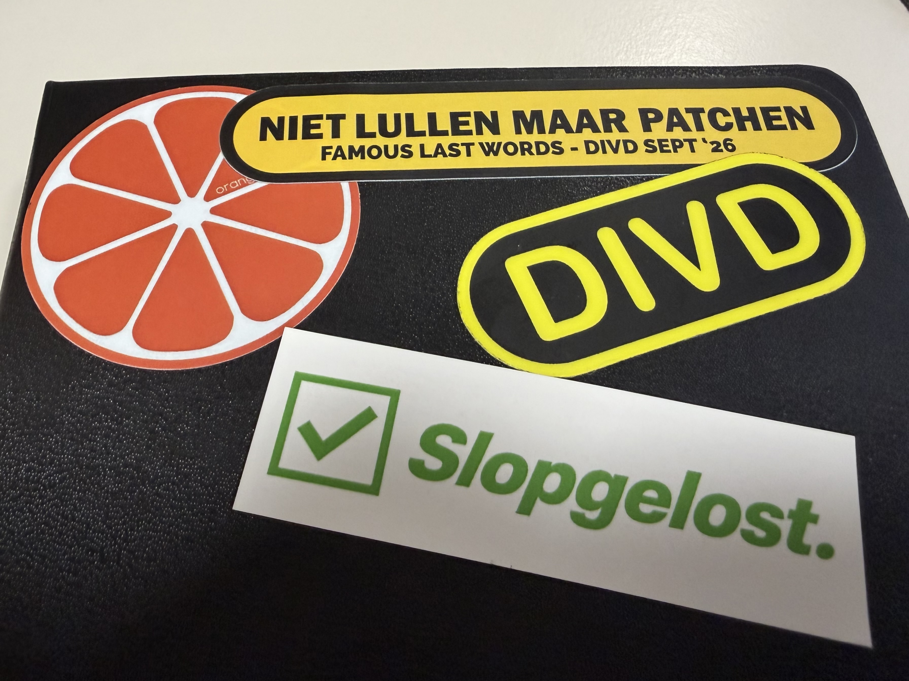

## Summary
DIVD was hacked in an attack involving AI agents. The forensic investigation of the breach has been completed. 

## What we know so far

On 21 September 2026, a malicious actor breached the Zammad instance that serves as our ticketing system for communications with csirt@divd.nl and all other email addresses ending in @csirt.divd.nl. The attacker exploited two zero-day vulnerabilities ( and ), which we have since reported to Zammad through case . Zammad has fixed both vulnerabilities: the first in release 7.2 and the second in release 7.2.2.

After obtaining root privileges on the system, the attacker used AI agents to continue the attack. Several indicators point to the use of AI agents, most notably:
* The sheer volume of attack activity and the number of artefacts generated in a relatively short period.
* The extensive comments and documentation in the attack scripts, including comments in which the attack agents appear to communicate with one another.

Within minutes of the attack, the first indicators appeared in our monitoring system, and an alert was sent to our SOC volunteers for investigation. 

Although the alert arrived quickly, it took us 19 hours to initiate our first response on 22 September 2026. During that response, we formulated a plan to contain the attack.

Executing this plan took a further nine hours. This included travel time to bring the incident response team together at the [Hermit Hive](https://hermithive.nl/), our friendly hackerspace home away from home. It also required careful coordination to ensure that we could isolate our systems in the Amsterdam data centre without cutting off our own network access and preventing the further response actions we knew would be needed.

Since then, we have investigated the incident to determine which data was involved. We have also informed our key partners and reported the breach to the [Dutch Data Protection Authority](https://www.autoriteitpersoonsgegevens.nl/en/about-the-ap) and the [Dutch Cyber Security Center (NCSC-NL)](https://www.ncsc.nl), and, through them, to our regulator under the [Cyberweerbaarheidswet](https://www.rdi.nl/onderwerpen/digitale-weerbaarheid/cyberbeveiligingswet/meldplicht). We have also filed a police report.

To provide as much clarity as possible, we created an [overview page](/DIVD-2026-00014/overview_data_investigation/) showing what data we hold, the status of the investigation and which data was affected by the breach.

We wouldn’t be DIVD if we hadn’t launched case  to warn other Zammad users who could fall victim to the same zero-day vulnerabilities. And yes, since the Zammad 7.x branch was not vulnerable and we were not running it, we had special stickers made to remind ourselves to practise what we preach. Stop yapping, start patching.

## Metrics

We are nerds. Nerds love metrics. Here are metrics.

| Metric                      | Time (HH:MM:SS) |
| ----------------------------|-----------------|
| Mean Time to Detect (MTTD)  | 00:15:11        |
| Mean Time to Acknowledge    | 07:20:00        |
| Mean Time to Respond (MTTR) | 11:56:00        |
| Mean Time to Contain (MTTC) | 27:40:00        |

We said we love metrics, but being the perfectionists we are, we see plenty of room for improvement. Then again, looking at the bigger picture, these numbers are not too shabby compared with industry averages, especially for a volunteer-run organisation.

And to give you an impression of the attack, here are some metrics relating to the adversary:

| Metric                                | Time (HH:MM:SS) / Volume |
| --------------------------------------|--------------------------|
| Time between first probe and first breach | 11:47:20 |
| Time from first breach to root           | 00:19:01 |
| Probe to root                         | 12:06:21 |
| Custom-written payloads recovered     | 990      |
| Output directories created            | 228 (excluding subdirectories) |
| Output files generated and recovered | 3,259 (excluding files in subdirectories) |

## Public statements

We made a number of public statements about this hack on social media. So many, in fact, that we moved them to the [public statements](/DIVD-2026-00014/public_statements_on_hack/) page.

## More information
* Case  - The case file for the zero-day vulnerabilities in Zammad
* [Overview of the compromise status of our data](/DIVD-2026-00014/overview_data_investigation/)
* Overview of [public statements](/DIVD-2026-00014/public_statements_on_hack/)

We will update this page when we have more information. 

  Leave this here, so we see a timeline. 


## Contact

For general questions about the breach, please contact [communications@divd.nl](mailto:communications@divd.nl?subject=Question%20about%20DIVD%20breach). If you have concerns about your personal data, please contact [dpo@divd.nl](mailto:dpo@divd.nl?subject=Data%20status%20inquiry%20DIVD%20hack). 
 